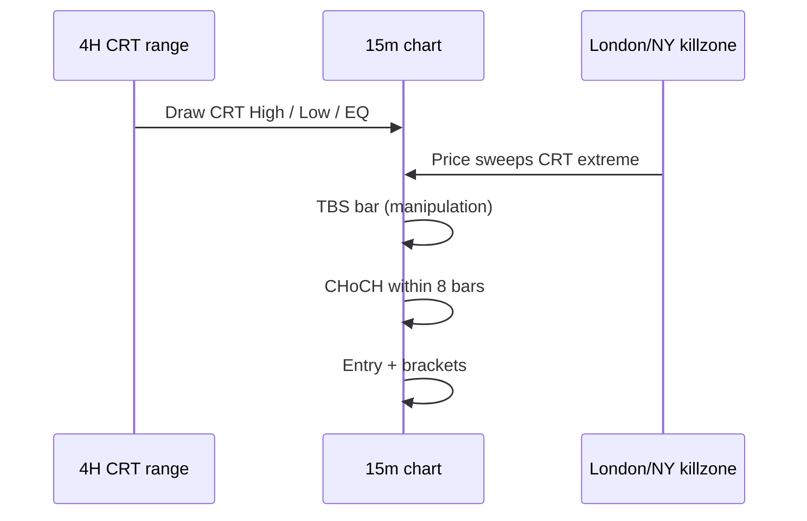

# CRT + TBS — Chart Analysis & Trade Marking Guide

How to read a chart with **Candle Range Theory (CRT)** and **Turtle Body Soup (TBS)** the same way the bot does, and what each overlay on a backtest trade means.

**Strategy code:** `backend/src/strategy/techniques/crtTbs.js`  
**Default preset:** `CRT_TBS` on BNBUSDT **15m** with a **4H** reference candle  
**Vocabulary:** see also `docs/TRADING_GLOSSARY.md` (CHoCH, sweep, premium/discount, killzone)

---

## 1. Big picture

CRT+TBS is an **ICT-style intraday reversal** model:

1. A **completed higher-timeframe candle** defines the “dealing range” (CRT).
2. On the **lower timeframe**, price **sweeps** one extreme of that range during a **session killzone** — this is the **manipulation** phase.
3. A **Turtle Body Soup** candle confirms the sweep failed (wick through the level, body closes back inside).
4. A **Change of Character (CHoCH)** within a few bars confirms **distribution** is starting.
5. You **enter** in the direction of the reversal; **TP1** targets equilibrium, **TP2** the opposite CRT extreme.



**Deployed default (BNB):** longs only (`crtTradeSides: LONG`) — sweep of **CRT low** → long toward EQ / CRT high.

---

## 2. Timeframes

| Layer | Timeframe | Role |
|-------|-----------|------|
| **Reference (HTF)** | **4H** (`crtHtfMs`) | Defines CRT high, low, equilibrium |
| **Execution (LTF)** | **15m** (preset) | TBS, CHoCH, entry, SL/TP |

### Which 4H candle is “the CRT”?

The engine uses the **last fully completed 4H candle** before the current 15m bar:

- While a 4H candle is still forming, levels come from the **previous** closed 4H bar.
- When a new 4H candle opens, levels update — but a **pending TBS setup locks** its CRT high/low at registration time until CHoCH fires or the setup expires (8 bars).

**On your chart:** mark the **prior closed 4H** OHLC, not the candle still printing.

---

## 3. CRT levels to draw first

For the reference 4H candle, draw three horizontal lines across your 15m chart:

| Line | Price | Meaning |
|------|-------|---------|
| **CRT High** | 4H high | Upper boundary — liquidity pool above (short target / long TP2) |
| **CRT Low** | 4H low | Lower boundary — liquidity pool below (long entry zone / short TP2) |
| **EQ (Equilibrium)** | `(high + low) / 2` | 50% of range — **TP1** and premium/discount divider |

Optional shading:

- **Discount** (below EQ) — preferred area to **buy** after a low sweep.
- **Premium** (above EQ) — preferred area to **sell** after a high sweep.

```
CRT High ─────────────────────────  ← resistance / sell-side liquidity
           ╲ premium ╱
EQ       ─ ─ ─ ─ ─ ─ ─ ─ ─ ─ ─ ─  ← TP1, fair value
           ╱ discount ╲
CRT Low  ─────────────────────────  ← support / buy-side liquidity
```

### Range quality filter

The bot skips tiny ranges:

- Range ≥ **0.25%** of price (`crtMinRangePct`)
- Range ≥ **0.4 × ATR** (`crtMinRangeAtr`)

If the 4H candle is a doji, levels are valid visually but the strategy will **not** trade.

---

## 4. Session killzones (when manipulation must happen)

TBS must occur on a bar inside **London** or **New York** open (UTC):

| Session | UTC hours | Notes |
|---------|-----------|-------|
| **London** | 07:00 – 10:00 | Manipulation often at LO |
| **New York** | 12:00 – 16:00 | Includes overlap 14:00–16:00 |

**Rule in code:** killzone is checked on the **TBS bar**, not necessarily on the entry bar.

**On your chart:** highlight the London/NY windows (vertical bands). The **sweep + TBS candle** should fall inside one of them.

---

## 5. Step-by-step chart analysis (LONG example)

Below is the **long** path (CRT low sweep). Mirror for shorts at CRT high when `crtTradeSides: BOTH`.

### Step A — Identify CRT

1. Open **4H** chart → pick the **last closed** candle.
2. Copy **high**, **low**, **EQ** to the **15m** chart.
3. Confirm range passes size filters (not a flat candle).

### Step B — Wait for sweep + TBS (manipulation)

On 15m, at **CRT Low**:

1. **Sweep:** wick pierces below CRT low by at least **0.06%** (`crtSweepPct`).
2. **Reclaim:** same candle **closes back above** CRT low.
3. **Turtle Body Soup (TBS):**
   - Lower wick ≥ **32%** of candle range (`crtMinTbsWick`)
   - Body ≥ **25%** of range (`crtMinBodyRatio`) — not a pure pin/doji
   - Close **above** the level (body soup, not wick-only soup)

```
        ┃  ← upper wick (small)
        ┃
   ─────┨───── CRT Low
        ┃▓▓▓   ← body closes ABOVE level
        ┃
        ┗━━     ← long lower wick (sweep)
```

4. **Premium/discount:** TBS **close ≤ EQ** (buy in discount).
5. **Killzone:** TBS bar timestamp in London or NY.

**Mark on chart:**

- **Pink dotted** — CRT low (sweep level)
- **Rose dashed** — sweep wick low (SL reference)
- **Circle/marker** — “Sweep” at wick, “Reclaim” at TBS close
- **Vertical band** — session killzone

At this point the bot registers a **pending setup** — no entry yet.

### Step C — CHoCH (distribution confirmation)

Within **8 bars** after TBS (`crtChochMaxBars`), price must print a **bullish CHoCH**:

- Prior micro-structure was **bearish** (or neutral).
- A 15m bar **closes above** the last internal **lower high** (last LH / swing high before the break).

**Mark on chart:**

- **Fuchsia dashed** — CHoCH level (the LH that was broken)
- **SH/SL markers** — swing highs/lows used by structure logic
- Label the CHoCH bar

CHoCH can be **1–8 bars** after TBS; it does **not** have to be the same candle.

### Step D — Entry

**Entry fires on the CHoCH bar** (or the bar where structure confirms), at **signal close** (`intradayLiqEntryAtSignalClose`).

**Mark on chart:**

- **Cyan dashed** — entry fill
- **Direction arrow** — long above entry candle

### Step E — Brackets (SL / TP1 / TP2)

| Level | Long formula | Purpose |
|-------|--------------|---------|
| **Stop** | sweep wick low × (1 − 0.15%) | Below manipulation wick |
| **TP1** | CRT **EQ** (or 0.5R if EQ already passed) | Partial take (~50%) |
| **TP2** | CRT **high** | Runner to opposite extreme |

After TP1, stop often moves to **breakeven** (`intradayLiqBreakevenAfterPartial`).

**Mark on chart:**

- **Red dashed** — stop loss
- **Lime/violet dotted** — TP1 partial
- **Purple dotted** — TP2 / opposing liquidity
- **Green/red bands** — reward / risk zones (optional)

---

## 6. Short setup (when enabled)

Set `crtTradeSides: BOTH` to allow shorts. Flow mirrors longs at **CRT High**:

| Step | Short rule |
|------|------------|
| Sweep | Wick **above** CRT high + close back **below** |
| TBS | Upper wick ≥ 32%, body ≥ 25%, close below level |
| Premium/discount | TBS close **≥ EQ** (sell in premium) |
| CHoCH | **Bearish** CHoCH — close below last HL |
| Entry | Sell |
| SL | Above sweep wick high |
| TP1 | EQ |
| TP2 | CRT low |

Default BNB preset uses **LONG only** because shorts hurt backtest PnL.

---

## 7. What the backtest trade chart shows

When you click a CRT+TBS trade in the app backtest, overlays come from `liqContext` (level type `crt_range`). Toggle layers in the **chart legend**.

| Overlay | Color / style | Layer id | Meaning |
|---------|---------------|----------|---------|
| CRT sweep level | Teal/orange zone | `liq_sr_zone` | CRT low (long) or high (short) |
| Sweep wick | Rose dashed | `liq_sweep_wick` | Extreme wick — SL anchor |
| Opposing liquidity | Purple dotted | `liq_opposing` | CRT high (long TP2) or low (short TP2) |
| CHoCH level | Fuchsia dashed | `smc_choch` | Structure break (if smcMeta present) |
| Swing points | ▲▼ SH/SL | `swings` | Pivots for CHoCH detection |
| Entry | Cyan dashed | `strategy_entry` | Fill price |
| Stop | Red dashed | `strategy_sl` | Stop loss |
| TP1 | Lime dotted | `strategy_tp1` | Equilibrium partial |
| TP2 | Violet dotted | `strategy_tp` | Opposite CRT extreme |
| Sweep events | ○ markers | `sweep_events` | Sweep & reclaim labels |
| Risk / reward bands | Shaded | `risk_band`, `reward_band` | Entry → SL / TP |

**Entry reason** in trade details: `crt_tbs_tbs_crt_low_choch` = long from CRT low, TBS registered, CHoCH confirmed on a later bar.

---

## 8. Full marking checklist (manual or TradingView)

Use this order every time:

- [ ] **1. CRT High** — horizontal, full session width  
- [ ] **2. CRT Low** — horizontal  
- [ ] **3. EQ** — dashed midline  
- [ ] **4. Killzone** — shade London (07–10 UTC) and/or NY (12–16 UTC)  
- [ ] **5. TBS candle** — box around manipulation bar; mark sweep wick  
- [ ] **6. CHoCH** — line at broken LH/HL; arrow on confirming close  
- [ ] **7. Entry** — arrow at CHoCH bar close  
- [ ] **8. SL** — below sweep wick (long)  
- [ ] **9. TP1 @ EQ** — partial target  
- [ ] **10. TP2 @ opposite CRT extreme**  

---

## 9. Filters that block a trade (no entry mark)

Even if it *looks* like CRT+TBS, the bot **will not** enter when:

| Filter | Config key | Blocks when |
|--------|------------|-------------|
| Range too small | `crtMinRangePct`, `crtMinRangeAtr` | 4H candle too tight |
| Wrong session | `crtKillzoneOnTbsBar` | TBS outside London/NY |
| No TBS | `crtMinTbsWick`, `crtMinBodyRatio` | Weak reclaim candle |
| Wrong side of EQ | `crtPremiumDiscountFilter` | Long above EQ / short below EQ on TBS bar |
| No CHoCH in time | `crtChochMaxBars` (8) | No structure break within 8×15m bars |
| Long-only | `crtTradeSides: LONG` | All CRT-high / short setups ignored |
| Daily cap | `crtMaxTradesPerDay` (2) | Already 2 entries today |
| Cooldown | `crtMinBarGap` (4) | &lt; 4 bars since last entry |

---

## 10. Worked example — Feb 28, 2026 (BNB 15m)

High-quality long from the Jan–Jun 2026 backtest:

| Phase | Time (UTC) | What happened |
|-------|------------|---------------|
| CRT | 4H ending 04:00 | Low **590.51**, High **615.35**, EQ **602.93** |
| TBS | 09:00 | Swept to **589.06**, closed **592.54** — London killzone, discount |
| CHoCH | 09:00–11:00 | Bullish CHoCH within 8 bars |
| Entry | 11:00 | Long **~595.83** — below EQ ✓ |
| TP1 | — | Partial near EQ extension |
| TP2 | — | Full target **615.35** (CRT high) |

**Why it’s textbook:** wide CRT range, TBS in London, entry in discount, large room to EQ and CRT high.

**Marginal example (often loses):** entry **above EQ** with CRT high only a few ticks away — rules allow it, but R:R to TP2 is tiny. Discretionary traders often skip these.

---

## 11. ICT phase map on one chart

```
  CRT High ═══════════════════════════════════  TP2 (long)
           │         premium zone            │
  EQ       - - - - - - - - - - - - - - - - -  TP1
           │         discount zone           │
  CRT Low  ═══════════════════════════════════  sweep target
           │
           │  ◄── Killzone ──►
           │      ┌─ TBS bar (sweep wick)
           │      │    ┌─ CHoCH bar
           │      │    │   ▲ Entry
           ▼      ▼    ▼   │
         manipulation → distribution → entry
```

---

## 12. Quick reference — preset numbers

From `backend/src/strategy/presets/crtTbsOptimized.js`:

| Parameter | Value |
|-----------|-------|
| HTF | 4H |
| LTF | 15m |
| Sweep depth | 0.06% beyond level |
| Min TBS wick | 32% of range |
| Min body | 25% of range |
| CHoCH window | 8 bars |
| Max trades / day | 2 |
| Sides | LONG (BNB default) |
| Killzone | LONDON_NY on TBS bar |
| TP1 | EQ (50% partial) |
| TP2 | Opposite CRT extreme |
| SL buffer | 0.15% beyond sweep wick |

---

## 13. Related commands

```bash
# Funnel audit for a date window
cd backend && FROM=2026-06-01 TO=2026-06-08 node scripts/audit-crt-tbs-window.mjs

# Per-trade rule audit for last backtest run
cd backend && node scripts/audit-crt-tbs-trades.mjs

# Unit tests for TBS detection
cd backend && node --test src/strategy/techniques/crtTbs.test.mjs
```

---

## 14. Summary

| Question | Answer |
|----------|--------|
| What defines the range? | **Prior closed 4H** high / low / EQ |
| When is manipulation? | **TBS** at CRT extreme in **London/NY** |
| When do we enter? | **CHoCH** within **8** 15m bars after TBS |
| Where is SL? | Beyond **sweep wick** |
| Where is TP? | **EQ** (partial) → **opposite CRT extreme** (runner) |
| What to mark? | CRT lines, killzone, TBS, CHoCH, entry, SL, TP1, TP2 |

Read the chart **top-down**: HTF range → session → sweep → structure shift → execution brackets.
