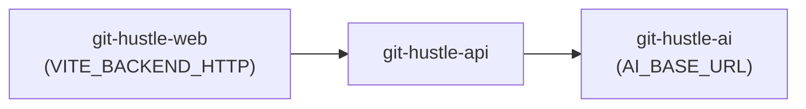

# Deployment plan: three Railway services — project **git-hustle**

This plan splits the stack into **AI (FastAPI)**, **Backend (Node + WebSocket)**, and **Frontend (static SPA)** as **separate Railway services** under a single project named **`git-hustle`**. It matches the repo layout: `ai-service/Dockerfile`, `backend/Dockerfile`, `frontend/Dockerfile`, and optional config-as-code under `deploy/railway-*.toml`.

---

## Goals

| Service        | Role                         | Public URL usage                                      |
|----------------|------------------------------|-------------------------------------------------------|
| **AI**         | `/health`, `/predict`, train | Backend calls this over HTTPS (`AI_BASE_URL`)         |
| **Backend**    | REST `/api/*`, `GET /health`, `wss://…/ws` | Browser + frontend fetch this (`VITE_BACKEND_HTTP`) |
| **Frontend**   | Static UI (`serve`)          | End users open this in the browser                    |

---

## Prerequisites

1. **GitHub**: Application code is pushed to the branch you will deploy (e.g. `main`).
2. **Railway account** with permission to create a project and connect the repo (ideally **two** GitHub connections if you use Railway’s GitHub app).
3. **Optional**: Remove or stop the old **monolith** service (single root `Dockerfile`) once the three services are healthy, to avoid duplicate spend and confusion.

---

## Phase A — Create project and three empty services

1. In [Railway](https://railway.app) → **New project** → name it **`git-hustle`** (exact name as you prefer).
2. Add **three** services; recommended names:
   - `git-hustle-ai`
   - `git-hustle-api`
   - `git-hustle-web`
3. For **each** service:
   - **Source**: connect the **same GitHub repository** as the monolith.
   - **Branch**: e.g. `main`.
   - **Root directory**: leave **empty** (repository root). All Dockerfiles use **root** context (`COPY backend/...`, `COPY ai-service/...`, etc.).
   - **Settings → Config as code** (recommended):
     - AI → `deploy/railway-ai.toml`
     - API → `deploy/railway-backend.toml`
     - Web → `deploy/railway-frontend.toml`  
   - Or set **Dockerfile path** manually: `ai-service/Dockerfile`, `backend/Dockerfile`, `frontend/Dockerfile` respectively.

Do **not** set the service root to `backend/`, `frontend/`, or `ai-service/` only — builds will fail.

---

## Phase B — Deploy **AI** first (`git-hustle-ai`)

1. **Networking** → **Generate domain** → note `https://<ai-host>` (no trailing slash).
2. **Variables** (optional overrides):

   | Variable    | Example / note                                        |
   |------------|--------------------------------------------------------|
   | `PORT`     | Default `8001`; Railway may inject `PORT` — image uses it in `CMD`. |
   | `MODEL_DIR`| Default `/app/data/model` in `ai-service/Dockerfile`. |

3. **Volume (strongly recommended)**  
   - Mount path: `/app/data/model`  
   - Keeps `model.pkl` across deploys. Align `MODEL_DIR` if you use a different mount path.

4. **Deploy** → verify:

   ```text
   GET https://<ai-host>/health
   ```

   Expect JSON with `"ok": true` (and model meta if a model exists).

---

## Phase C — Deploy **Backend** (`git-hustle-api`)

1. **Networking** → generate domain → note `https://<api-host>`.
2. **Variables** (minimal split setup):

   | Variable          | Value |
   |-------------------|--------|
   | `AI_BASE_URL`     | `https://<ai-host>` — **no** trailing slash. |
   | `LISTEN_HOST`     | `0.0.0.0` |
   | `SERVE_FRONTEND`  | `0` |
   | `FRONTEND_ORIGIN` | Set to `https://<web-host>` **after** frontend domain exists (step D); update backend and **redeploy** if CORS fails on first try. |
   | `NODE_ENV`        | `production` |
   | Plus              | `TRADING_MODE`, `MARKET_FEED`, Binance keys, `DEFAULT_SYMBOL`, etc. — same semantics as `docs/RAILWAY_DEPLOY.md`. |

3. **Important (split vs monolith)**  
   - There is **no** `scripts/docker-entrypoint.sh` in the backend-only image — **no** automatic Binance ping → `SYNTH` switching. Set `MARKET_FEED` explicitly (e.g. `BINANCE_FUTURES` or `SYNTH` per your region).

4. **Deploy** → verify:

   ```text
   GET https://<api-host>/health
   GET https://<api-host>/api/ai/health
   ```

---

## Phase D — Deploy **Frontend** (`git-hustle-web`)

1. **Build-time variables** (required for split host):

   | Variable             | Scope on Railway | Value |
   |----------------------|------------------|--------|
   | `VITE_BACKEND_HTTP`  | **Available at build time** (and runtime if UI needs it) | `https://<api-host>` — no trailing slash. |

   The `frontend/Dockerfile` passes this as a build `ARG` / `ENV` so `vite build` embeds the API origin. If this is missing, the UI will call the wrong host.

2. Optional: `VITE_BACKEND_WS` — usually **omit**; `frontend/src/ws/store.ts` derives **`wss://<api-host>/ws`** from `VITE_BACKEND_HTTP`.

3. **Networking** → generate domain → `https://<web-host>`.

4. **Deploy** → open `https://<web-host>` in the browser; confirm API calls target `https://<api-host>` (Network tab).

5. **Finish CORS**: On **backend**, set `FRONTEND_ORIGIN` to `https://<web-host>` (comma-separate if multiple) and **redeploy** the API if the first load was blocked.

---

## Phase E — Verification checklist

| Step | Check |
|------|--------|
| AI | `GET …/health` OK |
| API | `GET …/health` OK; `GET …/api/ai/health` proxies to AI |
| Web | UI loads; login/state or health reflects API |
| WS | Browser connects to `wss://<api-host>/ws` (same origin as API, not frontend host) |
| Train/predict | Depends on Binance/network; if `451`, use synthetic train or eligible IP (see `docs/RAILWAY_DEPLOY_SPLIT.md` §5) |

---

## Phase F — CLI (optional)

If you use [Railway CLI](https://docs.railway.app/develop/cli):

1. `railway login` (or `railway login --browserless`).
2. `railway link` → select project **`git-hustle`** and each service when setting variables.
3. `railway variables set KEY=value --service <service-name>`
4. `railway up` only applies to **linked** service; repeat per service or rely on GitHub auto-deploy.

---

## Phase G — Retire the monolith

When `git-hustle-ai` / `git-hustle-api` / `git-hustle-web` are stable:

1. Pause or delete the old **single-container** service (root `Dockerfile` + `railway.toml`) in **`btc-ai-pro`** or wherever it lived.
2. Point DNS/bookmarks to **`https://<web-host>`** only; API and AI stay on Railway-generated URLs unless you add custom domains.

---

## Quick reference — file map

| Asset | Path |
|--------|------|
| AI image | `ai-service/Dockerfile` |
| API image | `backend/Dockerfile` |
| Web image | `frontend/Dockerfile` |
| Railway config (optional) | `deploy/railway-ai.toml`, `deploy/railway-backend.toml`, `deploy/railway-frontend.toml` |
| Split doc (detail) | `docs/RAILWAY_DEPLOY_SPLIT.md` |
| Single-service doc | `docs/RAILWAY_DEPLOY.md` |

---

## Dependency order (summary)



Deploy **AI → API → Web**, then set **`FRONTEND_ORIGIN`** on API after **Web** has a URL.
