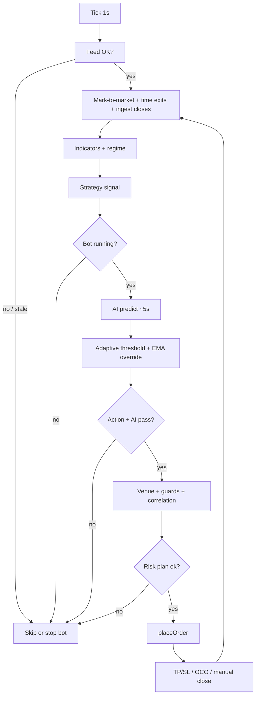

# Trading system: end-to-end flow and features

This document describes how a trade moves from market data to execution and exit, and how major parts of the app support that process.

---

## Architecture overview

| Layer | Role |
|--------|------|
| **Frontend (React)** | Dashboard: chart, portfolio, logs, controls, WebSocket client |
| **Backend (Node / Express)** | Bot loop, strategies, risk, exchange adapters, REST + WebSocket |
| **AI service (FastAPI / Python)** | Feature build, ensemble model inference, calibration, training from Binance |

Typical deployment: frontend talks to backend HTTP + WS; backend calls AI service over HTTP.

---

## Complete flow: from tick to trade (and exit)

The bot runs on a **~1 second timer** with a **re-entrancy guard** so two ticks never overlap (avoids double orders).

### Phase 1 — Market data and safety

1. **Candle buffer**  
   The market feed (Binance spot WS when `MARKET_FEED=BINANCE`, USDT-M `fstream` when `MARKET_FEED=BINANCE_FUTURES`, or synthetic) maintains OHLCV for the active **symbol** and **timeframe**.

2. **Feed health**  
   - If the bot is **running** and the feed is unhealthy or **stale &gt; 60s**, the bot **auto-stops**.  
   - After a **symbol switch** (e.g. universe rotation), a **grace period** skips decisions until the stream matches the new symbol (avoids mixing prices).

3. **Mark-to-market**  
   The exchange layer updates open positions / syncs with the venue using the latest price.

4. **Time-based exits** (optional)  
   If `MAX_POSITION_AGE_MS` is set, positions older than that are closed via `closePosition` (frees capital in dead trades; aligns with horizon-style labeling).

5. **Closed-trade ingestion**  
   `ingestClosedTrades`:
   - Loads new trades since the last seen id (monotonic id cursor; safe if the buffer is capped).
   - On each **CLOSE**: updates strategy stats, **performance window**, **drawdown**, **RL bandit**, sends **feedback** to the AI service, and may trigger **auto-retrain** if configured.

---

### Phase 2 — Regime, account, and daily loss

6. **Indicators**  
   TA features (EMA, RSI, MACD, ATR, Bollinger, etc.) are computed from candles.

7. **Regime detection**  
   Classifies conditions (e.g. **TRENDING**, **VOLATILE**, **SIDEWAYS**) with **confirmation** over several candles so labels do not flicker.

8. **Account and positions**  
   Fetches balance/equity and open positions (including **hybrid** spot + futures for `BINANCE_DEMO_API`).

9. **Mark-to-market for UI**  
   Unrealized PnL is attached per position; **USD-M futures** from the exchange can use **API-reported** unrealized PnL.

10. **Max daily loss (per venue)**  
    For hybrid accounts, **worst** daily PnL% across **spot** and **futures** legs is compared to `maxDailyLoss`. If breached, the bot **stops** and broadcasts state.

---

### Phase 3 — Strategy signal

11. **Strategy selection**  
    - **AUTO**: `pickStrategyAuto` chooses a strategy using **regime**, **indicators**, and **historical stats**.  
    - **MANUAL**: fixed strategy key (e.g. `EMA_CROSS`).

12. **Raw signal**  
    The active strategy returns **BUY**, **SELL**, or **HOLD** plus a reason.

---

### Phase 4 — AI scoring and gating

13. **AI predict (throttled)**  
    About every **5 seconds**, the backend sends recent candles to **`POST /predict`**. The AI service:
    - Builds the feature vector,
    - Runs the **ensemble** classifier(s),
    - Optionally applies **isotonic calibration**,
    - Returns **probability** (and **raw** probability for optional gating).

14. **Gate probability**  
    If `AI_GATE_USE_RAW` is enabled, the **raw** score is compared to the threshold; otherwise the **calibrated** probability is used (better probability semantics while allowing stricter raw gates).

15. **Venue awareness (early)**  
    **Spot** venues cannot short: a strategy **SELL** is turned into **HOLD** before overrides.

16. **Regime-adaptive threshold** (`RESTART_AI_REGIME_ADAPTIVE`, default on)  
    - **VOLATILE**: threshold ≥ **0.70** (high conviction only).  
    - **SIDEWAYS**: threshold ≥ **0.65**.  
    - **TRENDING**: threshold ≤ min(base, **0.50**) (easier to ride trend).  
    This steers trade frequency and quality by market state.

17. **AI + EMA override**  
    If the strategy is **HOLD** but AI is above the **adaptive** threshold, **EMA fast vs slow** can force **BUY** (or **SELL** on non-spot). Bridges “no pattern” bars with trend + model agreement.

18. **Hard AI filter**  
    If action is still **HOLD**, exit.  
    If **probability &lt; adaptive threshold**, log **“AI filter blocked trade”** and exit.  
    Only trades that pass both **strategy direction** and **AI confidence** (after overrides) proceed.

---

### Phase 5 — Venue, guards, and sizing

19. **Venue routing** (`marketMode`: **SPOT** | **FUTURES** | **AUTO**)  
    - **SPOT**: spot exchange only.  
    - **FUTURES**: futures only.  
    - **AUTO**: shorts go to **futures** if available; high volatility + confidence may prefer futures; else **spot**.  
    Helps match instrument to direction and risk.

20. **Operational guards**  
    - **Cooldown** between opens (`tradeCooldownMs`).  
    - **Max trades per hour**.  
    - **Max concurrent positions**.  
    - **Same symbol**: no duplicate open on the same pair.  
    - **Correlation guard** (`PORTFOLIO_MAX_CORRELATION`): e.g. avoid opening ETH while holding BTC when configured (reduces stacked beta).

21. **Auto-trading flag**  
    Real connectors (e.g. Binance Demo Spot) require **`supportsAutoTrading`** (e.g. `BINANCE_DEMO_ALLOW_AUTO=1`); otherwise the bot stops with a warning.

22. **Futures leverage**  
    **AUTO** mode sets leverage from model confidence, ATR%, and regime (capped). **MANUAL** uses UI/config leverage.

23. **Risk plan (`riskPlan`)**  
    - Position size from **risk per trade** × **balance**, stop distance ~ **ATR** (with a floor), R:R from volatility regime.  
    - **Kelly-style sizing** when enough closed trades exist (**fractional Kelly** scaled by confidence); otherwise **tier multipliers** by confidence.  
    - Caps notional vs **buying power** (including **leverage** on futures).  
    Outputs **qty**, **stopLoss**, **takeProfit** required for bracket/OCO style execution.

---

### Phase 6 — Execution and post-trade

24. **`placeOrder` on the venue**  
    - **Paper / sim**: simulated fills and brackets.  
    - **Binance Demo Spot**: **MARKET BUY** with **`quoteOrderQty`** (USDT spent), then **OCO SELL** for TP/SL (or flatten on OCO failure).  
    - **Demo / testnet futures**: market entry + **STOP_MARKET** / **TAKE_PROFIT_MARKET** with exchange filter rounding (**LOT_SIZE** / **PRICE_FILTER**).  
    Quantities and prices are rounded to exchange **step** / **tick** to avoid precision errors.

25. **Logging and UI**  
    **Trade OPEN** is broadcast on WebSocket; activity logs show **AI approved**, **Risk tier**, or **Order failed**.

26. **Execution quality**  
    After a successful open, the bot logs **intended vs filled price**, **slippage**, and **latency** (`execLog` / structured logs).

27. **Exit paths**  
    - **TP/SL** or **OCO** completion (venue-dependent).  
    - **Time exit** (`MAX_POSITION_AGE_MS`).  
    - **Manual close** via API.  
    On **CLOSE**, ingestion updates stats, **Sharpe-like** rolling stats on recent PnL window, **max drawdown**; if drawdown exceeds **`MAX_DRAWDOWN_PCT`**, the bot can **auto-stop**.

28. **Learning loop**  
    - **Feedback** rows to AI service for outcomes.  
    - **RL bandit** (lightweight): after enough trials, nudges an **adapted threshold** from recent win/loss reward.  
    - Optional **auto-retrain** from feedback when `RETRAIN_EVERY_CLOSED_TRADES` is set.

---

## Mermaid: decision path (simplified)

---

## App features and how they help

### Backend — bot and markets

| Feature | How it helps |
|---------|----------------|
| **1s tick + mutex** | Steady decisions without overlapping orders. |
| **Binance kline + aggTrade + depth feeds** | Live chart, delta, order book, realistic signals. |
| **Universe scan (AUTO coins)** | Ranks liquid symbols by volume, spread, optional AI score; rotates opportunity set. |
| **Symbol modes SINGLE / AUTO** | Manual pair vs automated coin picking with cooldowns to avoid churn. |
| **Strategy AUTO/MANUAL** | Regime-aware strategy pick or fixed playbook. |
| **Multiple strategies** | EMA cross, RSI mean reversion, breakout, momentum, ensemble — diversify rule sets. |
| **Regime detection + confirmation** | Stabilizes classification before sizing and strategy choice. |
| **AI gating + adaptive threshold** | Reduces low-edge trades in chop; allows trend following when regime is favorable. |
| **Kelly / tier sizing** | Scales size with edge and history; respects confidence bands. |
| **Daily loss + drawdown stops** | Circuit breakers across day and peak-to-trough equity. |
| **Cooldowns and position caps** | Limits over-trading and leverage stacking. |
| **Correlation guard** | Avoids pseudo-diversification (e.g. BTC + ETH long together). |
| **Hybrid demo (spot + futures)** | One mode with two wallets; routing by `marketMode`. |
| **Execution quality logging** | Tune slippage and latency over time. |
| **Feedback + optional auto-retrain** | Closes the loop from live outcomes to model updates. |

### Backend — HTTP API (selected)

| Endpoint | Purpose |
|----------|---------|
| `GET /health`, `GET /api/state` | Health and full snapshot (bot + account + positions + trades). |
| `POST /api/bot/start`, `/stop`, `/config` | Control bot and parameters. |
| `POST /api/mode/set` | Switch **PAPER**, **BINANCE_DEMO_API**, **BINANCE_TESTNET** (spot + futures testnet), **BINANCE_LIVE** (mainnet, guarded), etc. |
| `POST /api/trade/manual`, `/api/trade/close` | Human overrides with SL/TP semantics. |
| `GET /api/universe/scan` | On-demand universe snapshot. |
| `POST /api/ai/train-real`, `/api/ai/retrain` | Remote training and feedback retrain triggers. |
| `GET /api/backtest`, `GET /api/trading/evaluation` | Offline evaluation and checklist-style QA. |

### AI service

| Feature | How it helps |
|---------|----------------|
| **Feature engineering** | Maps candles + context (time, funding, sentiment where configured) into model inputs. |
| **Walk-forward training + purge gap** | Reduces leakage between train and validation time ranges. |
| **Risk-aligned labels (optional)** | Labels closer to how trades are actually managed (horizon, fee, SL/TP style). |
| **Ensemble models** | Averages multiple boosted trees; lower variance decisions. |
| **Calibration** | Probabilities better aligned for thresholding. |
| **Feature importance / pruning** | Fewer noisy features → often better out-of-sample behavior. |
| **Model versioning** | Timestamped artifacts for rollback and comparison. |
| **Atomic model IO** | Safer concurrent train vs predict on disk. |

### Frontend

| Feature | How it helps |
|---------|----------------|
| **Chart panel** | Visual context for price vs bot decisions. |
| **Trading / portfolio panels** | Mode, risk, leverage, start/stop, PnL context. |
| **Insights / training UI** | Trigger training, view validation metrics (e.g. top-decile lift). |
| **Logs panel** | See gating, errors, and lifecycle messages in real time. |
| **WebSocket + reconnect** | Resilient live state after network blips. |

---

## Configuration pointers (.env)

Important knobs (non-exhaustive):

- **Trading**: `TRADING_MODE`, `MARKET_FEED`, `AI_BASE_URL`, `AI_THRESHOLD`, `AI_REGIME_ADAPTIVE`, `AI_GATE_USE_RAW`, `RISK_PER_TRADE`, `MAX_DAILY_LOSS`, `MAX_DRAWDOWN_PCT`, `MAX_POSITION_AGE_MS`, `PORTFOLIO_MAX_CORRELATION`
- **Per-mode files** (default `data/modes/<paper|demo_api|testnet|live>/`): Activity log JSONL, trade WS audit JSONL, `bot-trading-config.json` (UI + last 10 Supertrend signals). Override with `ACTIVITY_LOG_PATH`, `TRADE_WS_LOG_PATH`, or `BOT_TRADING_CONFIG_PATH` to use one global file (not recommended for live vs demo).
- **Binance demo** (`BINANCE_DEMO_API`): `BINANCE_DEMO_*` (spot), `BINANCE_DEMO_FUTURES_*` (demo-fapi), `BINANCE_DEMO_ALLOW_AUTO`
- **Binance live** (`BINANCE_LIVE`): `BINANCE_LIVE_TRADING_ENABLED` (must be `1`), `BINANCE_LIVE_*` (spot), `BINANCE_LIVE_FUTURES_*` (mainnet fapi), `BINANCE_LIVE_ALLOW_AUTO`
- **Retrain**: `RETRAIN_EVERY_CLOSED_TRADES`, `RETRAIN_MIN_ROWS`

See `backend/.env.example` for the full list with comments.

---

## Related source locations

- Bot loop and trade logic: `backend/src/state/bot.js`
- Risk sizing: `backend/src/strategy/risk.js`
- Strategies / regime: `backend/src/strategy/`
- Exchange factory: `backend/src/state/exchangeFactory.js`
- HTTP routes: `backend/src/transport/http.js`
- AI client: `backend/src/svc/aiClient.js`
- AI service: `ai-service/app/main.py`

---

*Generated to describe the repository’s intended behavior; always verify against current code and your exchange’s rules before live trading.*
